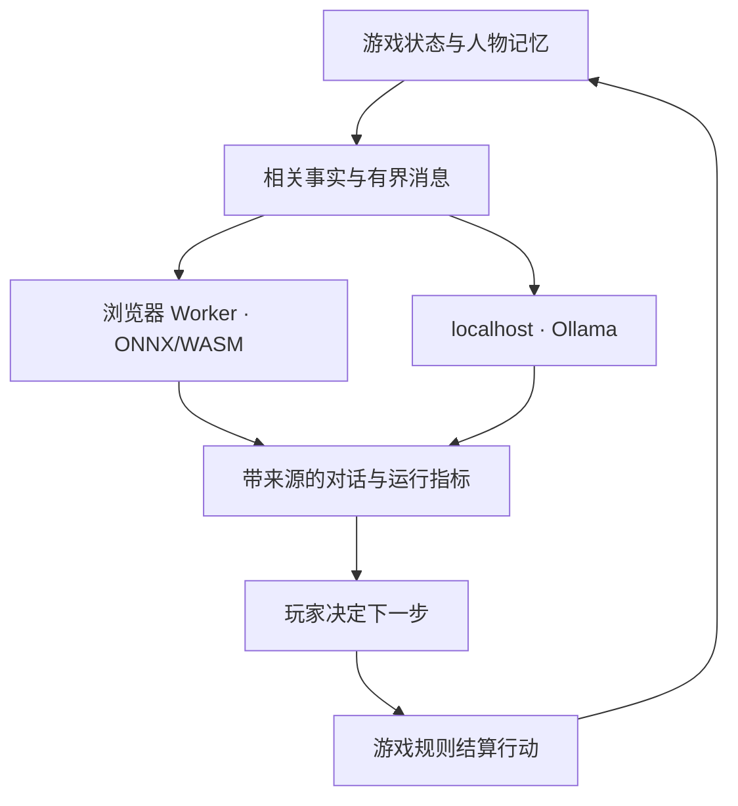

# 本地 AI DM：实现、离线运行与验收

> **v11 验收范围**：v10 在 2026-10-23 保存了真实 Native CPU 与浏览器 CPU/WASM 生成记录。v11 更新了事实分类、人物记忆及提示，旧记录不代表新提示已通过内容验收。本轮新增的逻辑回归与真实模型评估场景分别运行、分别记录；最终结果见 [验证记录](verification.md)。

v10 的模型模式会加载真实权重并执行文本生成。规则助手另有明确名称与来源标记；它仍然可以离线提供路线和基础提示，但不再被称为 Tiny LLM。

**默认模型配置是 Qwen3 0.6B q8，内容质量仍有边界。** 实现包括 Worker、分词器、ONNX 推理、流式回复、人物记忆和运行诊断。真实浏览器已从本地文件加载并生成正确的酒馆路线，Native CPU 事实与叙事评估仍发现错误。浏览器运行、事实准确性、角色扮演与设备表现必须分别验收，不能由“有输出”推断全部合格。具体范围见 [本页的内容验收](#当前模型的实测范围与限制) 与 [验证记录](verification.md)。

## 代码与责任

| 位置 | 责任 |
| --- | --- |
| [`../src/ai-dm.js`](../src/ai-dm.js) | 后端选择、加载状态、取消、对话、NPC 记忆、游戏事实、来源与诊断面板 |
| [`../assets/ai-worker.js`](../assets/ai-worker.js) | 在独立 Web Worker 中加载 tokenizer / ONNX 权重，实际调用文本生成 pipeline，报告 chunk 与 token 指标 |
| [`../models/registry.json`](../models/registry.json) | 模型 ID、精确 revision、文件清单、dtype、上下文预算、许可与运行库版本 |
| [`../tools/prepare_offline.py`](../tools/prepare_offline.py) | 下载固定版本权重和运行库，复用可校验的现有文件，准备并验证完整离线包 |
| [`../tools/package_release.py`](../tools/package_release.py) | 打包已构建游戏与源码；可加入一个精确匹配注册表的已验证离线模型 |
| [`../tools/serve.py`](../tools/serve.py) | localhost 静态服务，以及固定连接本机 Ollama 的有限桥接 |
| [`../src/bootstrap.js`](../src/bootstrap.js) | 保存/导入、v9 迁移、取消旧角色活动、恢复后不伪装模型仍已加载 |
| [`../src/service-worker.js`](../src/service-worker.js) | 游戏壳与指定运行库的缓存；模型缓存由 Transformers.js 管理 |

浏览器推理使用注册表指定的 Transformers.js 版本，`device: 'wasm'`、单线程 CPU 模式。推理在 Worker 中执行，游戏界面可以继续处理输入。这里的 Web Worker 是浏览器后台线程；多人服务器使用的 Cloudflare Worker 是另一套服务。



模型只返回文字。奖励、金币、属性、胜负、事件检定和结局写入由规则模块执行。模型说“获得一把剑”不会凭这句话给背包加物品；这种不符合事实的回复属于模型质量问题，应记录并改善。

## 浏览器模型的启动过程

Windows、macOS 与 Linux 均需要 Python 3.10+ 和现代浏览器。已构建游戏与完整离线包的日常游玩不需要 Node.js/npm。

1. 将交付 ZIP 完整解压，进入 `aethelgard-mud`；源码用户进入项目目录。用 `python tools/serve.py --open` 打开游戏，macOS/Linux 通常使用 `python3`；也可运行 Windows 的 `start_Windows.cmd` 或 macOS/Linux 的 `sh start_unix.sh`。
2. 打开“智脑”，选择“浏览器 CPU”。
3. 选择 **Qwen3 0.6B**。完整离线包或已运行准备工具的用户勾选“使用已下载的离线模型包”；轻量包直接联网加载时保持该选项关闭。本地文件模式点击“加载离线模型”，联网模式点击“下载并加载模型”。
4. 等待加载成功后提问。加载中、失败、未加载与生成中使用不同状态；没有就绪的模型不会生成“假成功”回复。
5. 展开“推理运行记录”，查看实际加载模型、成功加载次数、成功推理次数、最后一次运行的数据。

默认地址为 `http://127.0.0.1:8765/`，启动器终端需要保持开启。在本地文件模式中，按钮显示“加载离线模型”，文件从解压目录读取，无需互联网。不要通过 `file://` 打开 HTML 加载模型。

| 清单 key | 当前注册表配置 | 使用定位 |
| --- | --- | --- |
| `qwen-0.6b` | `onnx-community/Qwen3-0.6B-ONNX`，q8，WASM；聊天模板 `enable_thinking: false` | **默认中文模型**，也提供英文；有真实运行证据与已知质量问题 |
| `qwen-0.5b` | `onnx-community/Qwen2.5-0.5B-Instruct`，q4，WASM | 实验备选，不推荐作为当前交付默认值 |
| `smol-135m` | `onnx-community/SmolLM2-135M-Instruct-ONNX`，q4，WASM | 实验英文轻量模型，不推荐作为当前交付默认值 |

Qwen3 q8 的预计模型下载量为约 635 MB，运行库另计；精确 revision、文件、SHA-256、许可和参数以 [注册表](../models/registry.json) 为准。峰值内存、首 token 等待时间和生成速度不能从权重大小直接推断。当前注册表与离线包使用 Qwen3 q8，不得将其他量化文件直接换入默认包。

模型选择和下载进度本身不算推理成功。只有实际生成完成才增加成功推理计数。不同设备上的速度应以该设备的运行数据为准，不能沿用旧版“任意 CPU 小于 5ms”的说法。

## 离线运行的两种方式

### 方式 A：浏览器缓存

联网完成一次模型加载后，Transformers.js 尝试把模型文件保存在浏览器缓存中，Service Worker 缓存游戏壳与指定运行库。缓存可用且完整时，之后可以断网重新打开和加载。

浏览器的缓存权限、存储空间、清理策略和页面来源会影响这一方式。加载成功不等于已经通过“断网后重新加载”的测试。要验证，应在模型加载完成后关闭网络、重新载入页面、再次加载模型并完成一条真实回复。仅在已经驻留内存的模型上继续聊天，不能证明冷启动离线可用。

模型缓存和运行库缓存不可用时，界面会给出相应提示。通过 HTTPS 或 localhost 打开页面；`file://` 不作为模型运行入口。需要复制到另一台电脑时，采用下面的文件包方式更明确。

### 方式 B：提前下载完整文件包

轻量源码/游戏包不包含权重或运行库。在仍有网络时，进入项目目录准备默认模型：

```bash
python tools/prepare_offline.py --model qwen-0.6b
```

完整离线 ZIP 已经包含所需文件，解压后不必重复下载。准备工具只使用 Python 标准库，不要求 npm。不传 `--model` 时只准备注册表第一项；实验备选可按 key 选择，需要多个型号时在同一次命令中重复 `--model KEY`，例如 `--model qwen-0.6b --model smol-135m`。脚本读取注册表中的固定 revision，下载权重、配置和 tokenizer；同时准备以下内容：

| 目录或文件 | 内容 |
| --- | --- |
| `models/<模型仓库ID>/` | 实际模型配置、tokenizer 与注册表要求的权重；默认 Qwen3 q8 为 `onnx/model_quantized.onnx` |
| `vendor/` | Transformers.js 3.8.1 的 `transformers.min.js`、`ort-wasm-simd-threaded.jsep.mjs` 与 `ort-wasm-simd-threaded.jsep.wasm` |
| `models/offline-manifest.json` | 本次选择的模型版本、许可链接、文件清单与 SHA-256；加入型号时需同时列出想保留在清单中的型号 |
| 文件旁的 `.download.json` | 下载地址、大小和本次计算的摘要，用于后续检查已有下载 |

下载失败不会把未完成的 `.part` 文件当作完整权重。再次运行会检查可复用文件并重试所需下载。注册表若为某文件提供预置 SHA-256，下载器会核对该摘要；未提供时，下载记录是本次下载的校验基准，不应描述成独立的上游签名认证。

如果已经安装开发依赖，准备工具会检查项目内 `node_modules/@huggingface/transformers/package.json` 的版本是否为 `3.8.1`，自动尝试从对应 `dist/` 读取运行库，并核对内置的固定 SHA-256；不需要额外命令行参数。无法使用本地运行库时从固定版本地址下载。

已经存在的模型或运行库文件，只有摘要符合固定 SHA-256，或符合与本次固定下载 URL 完全一致的 `.download.json` 回执，才会复用；有大小要求时同时核对大小。仅有同名文件或目录不算版本证明。不符合条件的文件会重新下载，失败时保留原文件，不把半成品当作成功下载。清单在全部选定文件通过校验后原子写入；其他型号的文件可能仍留在磁盘上，但不会自动并入本次清单。

准备完成后，以及复制到新电脑后，执行：

```bash
python tools/prepare_offline.py --verify-only
```

这个模式不联网、不写文件，检查现有 manifest 中**所有已记录型号和运行库**的必需文件与实际 SHA-256；即使同时传入 `--model`，也不会缩小校验范围。运行库版本不符、缺文件、摘要不符、越出包目录的路径或缺少必要元数据会失败。校验成功证明文件与记录一致，并不证明模型输出质量，也不代替下一步的浏览器加载与断网运行测试。

随后启动 localhost 游戏，在“浏览器 CPU”中选择已下载的同一个 key，勾选“使用已下载的离线模型包”，再加载。加载前，页面核对 manifest 中的模型 key、ID、revision、dtype、运行库版本和所需文件记录，并核对注册表中已有的固定摘要。此模式从同源 `models/` 和 `vendor/` 获取文件，关闭远程模型下载。页面预检不是对数百 MB 权重重新计算 SHA-256；完整的文件字节校验由 `--verify-only` 完成。

需要复制到另一台电脑时，使用下面的打包工具生成完整 ZIP，完整解压后再校验和启动。手动复制则必须保留游戏壳、`assets/`、模型注册表、离线 manifest、对应模型文件、`vendor/`、启动器和校验工具的相对路径。普通静态站点发布不会自动包含本机大型模型或 `vendor/`。

### 制作轻量包与完整离线包

先生成与源码一致的游戏页面，再打轻量包：

```bash
python src/build_mud_game.py
python tools/package_release.py
```

默认输出为 `dist-release/aethelgard-v10-source.zip`。它包含已构建游戏、`src/`、测试、文档、构建配置、联机服务器代码和本地启动/准备工具，便于直接游玩规则内容及继续开发；不包含模型权重和推理运行库。

准备并打包默认模型：

```bash
python tools/prepare_offline.py --model qwen-0.6b
python tools/prepare_offline.py --verify-only
python tools/package_release.py --model qwen-0.6b
```

输出为 `dist-release/aethelgard-v10-qwen-0.6b-offline.zip`。两个 ZIP 都以 `aethelgard-mud/` 为根目录；完整包在轻量包的基础上加入一个型号的实际权重、配置、tokenizer、三份运行库文件和裁剪后的 manifest。可以使用 `--output /path/to/release.zip` 指定输出位置。

打包工具先检查构建是否过期，再调用准备工具现有的完整清单校验，最后要求所选模型的 ID/revision/dtype 与当前注册表精确匹配。它会检查源清单中的全部已安装模型；未选择的旧实验模型若已损坏，也会明确报错。通过校验后，仅将所选型号当前注册表要求的文件写入 ZIP，避免同一仓库里的实验 q4/q8 权重一并进入交付包。写入过程中再次校验被打包模型和运行库的摘要，失败时不会覆盖已有 ZIP。

文本使用 ZIP 压缩，ONNX 权重与 WASM 直接存储，避免无意义的模型压缩开销。包中不含 `node_modules`、开发缓存、Git 历史或本机存档；包含现有 [第三方许可说明](third-party-notices.md) 和许可原文，不修改项目源码的许可。这个命令只生成本地文件，不下载模型、不推送代码、不发布站点。

接收完整包的玩家只需提前安装 Python 3.10+ 和浏览器。解压后运行 `start_Windows.cmd` 或 `python3 tools/serve.py --open`，选择 Qwen3 0.6B 并启用离线文件模式即可；游玩不需要 npm 或在线下载。准备者仍应实际执行“断网、重载、重新加载模型、生成新回复”的验收，而不只检查 ZIP 能否打开。

## Ollama：保持模型服务在本机

先安装并启动 Ollama，再下载准备试用的本地模型。下面的安装示例与源码默认值一致，**不构成模型质量推荐**：

```bash
ollama pull qwen2.5:0.5b
ollama list
```

也可以选择其他已安装的本地模型。执行 `pull` 需要网络；已经下载且能够本机运行的模型可由本机服务推理。**本次没有运行真实 Ollama 模型进行验收**；现有测试验证了模拟响应下的流解析、状态与本地桥接边界。Ollama 模型与浏览器 ONNX q8 的文件、量化和运行配置不同，不能把这里的浏览器/Native ONNX 内容得分视作 Ollama 的验收结果。

当前客户端请求 `num_predict: 180`，只拼接 `message.content`，没有发送 `think: false`；同源桥接也没有保留思考控制字段。[Ollama 官方思考模式文档](https://docs.ollama.com/capabilities/thinking) 说明，未设置 `think` 时采用模型默认行为，思考内容与最终回答分别通过 `message.thinking`、`message.content` 返回。由此可推断，Qwen3 等思考模型若先生成较长思考，在当前短输出预算下可能尚未生成最终回答便结束，此时客户端会报告没有完整答案。这是接口与代码衔接上的风险判断，本次未用真实 Ollama 复现；因此安装示例保留 `qwen2.5:0.5b`，不将浏览器默认型号直接搬到 Ollama 示例。

使用项目启动器时，页面默认使用 `/ollama`：

| 页面请求 | 固定上游 |
| --- | --- |
| `GET /ollama/api/tags` | `http://127.0.0.1:11434/api/tags` |
| `POST /ollama/api/chat` | `http://127.0.0.1:11434/api/chat` |

进入智脑的 Ollama 页，点击“连接并检测模型”，选择实际已安装的本地型号后提问。“检测到服务和模型”不代表模型已驻留内存；首次提问可能包含加载等待。成功生成以后，界面会更新实际就绪状态。

请求设置 `num_gpu: 0`、有界输出与上下文。桥接只监听 `127.0.0.1`，检查 Host/Origin，限制请求体与消息结构，不暴露模型 pull/delete 等接口，不接受任意上游 URL。浏览器端和桥接端都拒绝带 cloud 标记或 URL 形式的模型标识。本机 Ollama 的实际运行位置还可以用 `ollama ps` 检查。

从其他静态站点直接连接 `http://127.0.0.1:11434` 时，浏览器本地网络权限、跨域配置或 HTTPS 页面策略可能影响连接。项目的 localhost 启动器使用同源桥接，避免让用户为日常游玩调整远端站点的跨域配置。不要把 Ollama 服务开放到公网来解决本地连接问题。

## 来源、计时与错误如何显示

| 来源值 | 意义 | 是否计入真实模型推理 |
| --- | --- | --- |
| `wasm` | 浏览器 Worker 完成的模型生成 | 是 |
| `ollama` | 本机 Ollama 完成的生成 | 是 |
| `rules` | 玩家主动选择的规则助手 | 否 |
| `rules-fallback` | 玩家允许回退后，在模型失败时给出的规则回复 | 否 |
| `legacy-rules` | 旧存档中的脚本回复 | 否 |

每条回复保留 `complete`、`error`、`cancelled` 或 `generating` 等状态。默认不在模型失败后自动给出模板成功消息；玩家可以主动启用明确标记的规则回退。

浏览器模式的 `latencyMs`、`firstTokenMs` 来自实际时钟，token 数来自实际分词结果与生成回调。Ollama 模式拼接真实 NDJSON 流，从完成包读取 `prompt_eval_count`、`eval_count`、`eval_duration` 与 `load_duration`；只有收到完成标志和非空回答才算成功。运行指标是这次运行的数据，不是按文字长度估算的展示数值。

加载时间、首 token 延迟、完整回答耗时和 token/s 衡量的不是同一件事。比较时应记录设备、浏览器、模型 revision/dtype、输入长度、输出上限，以及是首次加载还是缓存后的运行。

## 游戏事实与人物记忆

智脑读取当前地点、实际出口、人物状态、装备、任务、当前旅程目标、阵营信任与最近选择。战术问题使用真实敌人意图、体力、技能成本、冷却和可用补给；路线问题从现有世界图计算路线。导航、战术和资源状态的规则卡默认展开，标题注明“游戏规则 / 提问时的实际状态”；其他背景事实可展开查看。模型回复保留原文，历史规则卡保留提问时的快照，便于区分游戏事实与模型生成的气氛描写。

v11 由同一个 `classifyIntent()` 为模型提示、规则事实卡和规则助手分类。含“刚才、记得”的战斗追问仍保留当前生命、体力、敌人意图和合法动作；询问路线时保留战斗中的移动限制。推荐行动及打断效果读取 `CombatDirector.getContext().decisions`：打断施法取消本次施法，不能据此承诺下一回合出现破绽；打断蓄力的具体效果以战斗引擎给出的说明为准。模型只解释这些效果。

NPC 的事实卡明确列出说话者、玩家姓名、身份、所属阵营与真实信任值。当前人物相关的已结算故事会从保存的旅程日志中检索，优先匹配玩家问题、人物、地点及地区，再选择少量相关经历；已确认的长期故事标记补充关键后果。尚未选择的奇遇继续只传入开场，不向模型泄露可能奖励，也不使用旧聊天把未在场人物搬进现场。

NPC 私人对话仍按人物 ID 分隔；普通 DM 和战术使用 `dm` 会话。每个会话保留最近 12 条消息，最多发送最近 8 条；Worker 在实际 token 预算内继续移除最早完整对话。新增的长期玩家事实独立于这个短窗口保存，只提取玩家明确提供的人物姓名和承诺，例如：

- `我的姐姐叫米拉。` / `My sister is named Mira.`
- `我承诺寻找信使。` / `I promise to find the courier.`

这是保守的明确句式提取，不是任意自然语言都能形成长期记忆。姓名可以用相同句式更正；承诺始终标记为“玩家声明，不代表已履行”。系统不会从助手回复中提取事实、自动完成任务或给予物品。旧存档首次归一化时只从 `user` 历史迁移明确声明，忽略助手文字。

`state.ai.knowledge` 最多保存 40 个会话，每个会话 20 条事实。每次提问按相关词检索最多 4 条，放在最新消息内，因此不会随旧对话预算裁剪而消失。阵营和事件事实实时来自游戏状态；它们与“玩家声明”有不同来源。面板的“记住的人物与承诺”可查看当前会话记录，“清除对话记忆”清除聊天和这些声明，不清除游戏旅程本身。会话隔离和事实传入不能保证模型始终正确理解内容，仍须检查真实生成的人称及事实。

取消会停止当前请求；必要时终止浏览器 Worker。v11 会保留问题，显示“重新加载并继续”：点击后先复用已有缓存或本地文件加载，再发送保留的问题。缓存可能被清理，因而不承诺所有设备都无需补下载；离线文件模式仍只读取本地包。未载入模型时误点提问，也可以从这个入口继续。

继续前会核对人物、地点和奇遇 token；如果玩家已移动或完成原事件，就把问题放回输入框，请玩家针对当前情况重新提问。切换模型/后端或导入另一位人物时，迟到结果不能写入新请求或新人物。保存时还在生成的旧记录，在恢复后标记为已取消并保留已有文字；重新打开游戏不会伪装原来的模型仍然驻留。其他标签拥有存档写入权时，本页不会继续改变 AI 对话、记忆、设置或反馈。

### 本机回答反馈

每条完整回复下可选择“事实有误”“角色不一致”或“场景不符”。记录包含原问题、提问时保存的事实、原始回答、来源、模型及可用的 revision/dtype、运行库、地点、语言和游戏版本。它不会用当前状态替换旧回答的上下文，也不会自动改写原文。

最多保留 20 条记录，同一回复同一类别不重复添加。展开“回答反馈”即可导出 JSON 或清除记录。导出只在本机创建下载，不会上传，也不调用外部反馈服务；其中可能包含玩家告诉 NPC 的私人内容，玩家可以在自行分享前检查文件。反馈表示玩家报告，不能自动计作经过核实的模型失败。

无法解析或校验的旧存档会先按原文备份。若存储空间不足，连备份也无法写入，则暂时阻止自动保存覆盖原始数据；只有玩家明确新建人物或导入合法存档后才继续正常保存。这一保护与模型是否加载无关。

## 验证层次：分别证明什么

| 命令 | 能证明的范围 | 不能据此推断 |
| --- | --- | --- |
| `node tests/ai.test.mjs` 与 `node tests/ai-worker.test.mjs` | 实际模块的来源、状态、错误、取消、记忆、提示事实和 Worker 调度回归；外部响应明确 Mock | 没有加载真实权重，不能证明模型回答质量或性能 |
| `python tests/test_serve.py` | 实际 localhost HTTP 路由、静态资源、编码路径、Host/Origin 与桥接限制；Ollama 上游 Mock | 不能证明本机 Ollama 已安装或实际生成成功 |
| `python tools/prepare_offline.py --verify-only` | 本机离线包所有记录文件的存在性、必需文件覆盖与 SHA-256 | 不执行推理，不验证模型质量；摘要来源不自动等于上游签名认证 |
| `python tests/test_package_release.py` | 临时小文件构造的轻量包/模型包，精确裁剪、完整性失败与旧输出保护 | 使用 Mock 模型字节，不是大模型推理或完整交付包性能测试 |
| `npm run test:browser` | 实际页面启动、故事交互、保存/重载、离线加载控件与布局冒烟 | 默认不下载模型，不算真实推理验收 |
| `npm run test:model -- --model=qwen-0.6b` | 真正执行 Native ONNX CPU 模型；使用实际游戏提示与事实，记录双语路线、战术、记忆和指标 | 不是浏览器 WASM；自动事实断言也可能漏掉额外的虚构内容 |
| `node tests/browser.mjs --model` | 新浏览器环境中阻断外网、允许 localhost，真正从本地包加载 WASM 模型并生成路线回复 | Service Worker 被禁用，不证明浏览器缓存断网重载，也不能证明全部 NPC/战术/多轮质量 |

真实推理命令需要 `npm ci` 安装开发依赖，浏览器命令还需要 `npx playwright install chromium`。首次执行可能下载较大的模型文件。`tests/real-model.mjs` 在 VM 中加载实际游戏模块，由游戏状态与正式提示构造消息；界面/平台依赖被替代，但送入 Native ONNX 的权重与生成是真实的。`--prompts-only` 和 `--self-check` 只检查提示或评估逻辑，不算真实推理。测试失败应保留实际输出，不能用规则答案填充模型结果。

v11 的完整质量套件包含每种支持语言的 11 个场景：`route`、`interrupt`、`cast-interrupt`、`guard`、`mixed-guard`、`memory`、`long-memory`、`npc`、`npc-relationship`、`encounter`、`tavern`。长记忆场景在 8 条其他玩家消息之后回忆姓名与承诺；人物关系场景使用真实信任/故事标记；场景检查覆盖缺席信使、远处水车和未结算选择。自动判据仍可能漏判，所有叙事场景保留 `needs-human-review`，不会因非空输出直接合格。

```bash
# 不载入权重：只验证判据和当前游戏提示
node tests/real-model.mjs --self-check

# 已准备本地模型后：实际生成本轮重点场景，不允许远端补权重
node tests/real-model.mjs --local --lang=zh --case=mixed-guard,cast-interrupt,long-memory,npc,npc-relationship,tavern
```

### 当前模型的实测范围与限制

当前源码的真实运行结果、时间、原始回复和失败案例统一记录在 [验证记录](verification.md)。这些用例只覆盖特定模型、提示和设备，不是所有问题的总体准确率。没有恢复到原文的历史报告不作为当前证明。

**v11 中文定向生成（2026-10-24）**：使用本地 Qwen3 0.6B q8 的 6 个 Native CPU 场景，真实载入约 3.46 秒，6 条回复生成合计约 31.32 秒。混合“刚才”的零体力问题正确推荐防御；施法打断正确说明 18 体力与不保证破绽；长记忆同时取回米拉和寻找信使的承诺。该次玛拉欢迎语没有认错人物，酒馆氛围也没有把远处水车变成现场声音。

仍有明确失败：关系问答虽然说“戒备”，却编造了“因为你对我的信任和忠诚”，没有依据已记录的游侠钱袋事件；长记忆的信息正确，但使用第一人称复述玩家声明。追加更强指令的两例试验反而出现反问与复述要求，已撤回该提示试验并保留失败原文。最终提示与保留的 6 例生成提示逐条比对一致。不能将历史自动结果“3 passed、3 needs-human-review”当作 6 例叙事全部合格；关系判据随后收紧，用来捕捉这次漏判。完整报告和语义复核由 `test-results/ai-v11-native*.json` 保留。

以下为 v10 的既有运行范围，不能替代上述新提示的验收：

| 配置与场景 | 已观察到的结果 | 解释与限制 |
| --- | --- | --- |
| 默认 Qwen3 0.6B q8，Native CPU 双语事实场景 | 已重新运行，仍存在事实失败 | 英文防御回复仍可能虚构生命恢复；实际防御恢复体力与法力，不恢复生命。具体得分与原文见验证总表 |
| Qwen3 q8，Native 中文 NPC 与事件描写 | 已重新运行，叙事验收未通过 | NPC 身份、人称和选择边界需要人工阅读；非空文字不等于合格叙事，失败输出见验证总表 |
| Qwen3 q8，真实浏览器 CPU/WASM | 已从本地包实际加载，并生成正确的向南路线 | 外网请求被阻断、localhost 允许；这证明实际推理链和该条路线有效，不证明 Service Worker 缓存重载或全部回答准确 |
| Qwen2.5 0.5B q4 | 保留实验备选 | 未作为当前交付的默认质量配置；不能把默认 Qwen3 的测试结果套用到它 |
| SmolLM2 135M q4 | 保留实验英文轻量选项 | 不作为当前默认或推荐的游戏叙事配置；注册表提供该选项不构成质量合格声明 |

当前交付使用 Qwen3 q8。Native 事实用例只覆盖已保存的场景；更换提示、版本、量化或推理后端后应重新验收。任何模型自称已给予奖励、完成行动或改变生命，都不构成游戏状态变化。Ollama 真实推理、Service Worker 缓存的断网重载及更广泛的 NPC 长对话仍须分别验证。

### 后续内容验收

在标记一个型号为适用前，至少记录以下真实输出：

- **实际地图**：城镇广场询问旅馆，答案应指向南；用包含 “more” 的完整问法也不能错误理解成矿石。
- **中文与英文**：分别检查所声明语言，不能仅凭模型卡或 UI 标签推断中文体验。
- **战术事实**：体力不足时不得建议支付不起的打断；冷却技能、没有的药品不能被当作可用；首领意图应被正确理解。
- **NPC 与记忆**：回答符合当前人物身份，记得同一人物的近期对话，不串入另一名 NPC 的私有会话。
- **选择边界**：奇遇开场不替玩家选方案，不声称发放尚未结算的奖励。
- **离线与取消**：断网后重新加载和生成；生成中停止、换模型、导入人物后没有旧结果混入。
- **设备表现**：记录首次加载、暖启动、首 token、完整响应时间与可见界面是否仍可操作。

通过状态机测试、成功生成 token、回答有可读句子、内容遵循事实，必须分别记录。自动检查与人工阅读都应记录失败例；本地测试通过不代表远端 CI 已运行，打包成功也不代表已上传或发布。

## 后续更换模型

1. 在注册表更新 ID、固定 revision、dtype、文件清单、上下文预算、输出上限、许可与下载量。优先保持既有 key 稳定，便于旧设置迁移。
2. AI 默认使用注册表第一项。如果增加/更名 key，同时检查默认值、离线准备工具参数、测试脚本与 CI；不能只更换 UI 展示名。当前 CI 的真实浏览器模型目标为 `qwen-0.6b`；工作流配置本身不是成功运行证明。
3. 重新准备文件并运行真实 Native CPU 与浏览器 WASM 验证，确认 tokenizer/chat template、模型架构与当前运行库兼容。
4. 检查中英文任务、取消、多轮、离线重载和实际游戏事实；保存真实输出及失败案例。
5. 更新 README 的配置表与验收状态，再运行构建，保证两个 HTML 与 Service Worker 的构建标识一致。重新准备并校验模型包后打包，不把旧的量化配置混入新交付。

升级 Transformers.js 时，还须同步依赖版本、注册表、运行库文件清单和 Service Worker 缓存策略；不要让旧的离线运行库混用新的权重/推理配置。

## 常见问题

| 现象 | 检查方式 |
| --- | --- |
| “尚未加载”或要求先加载 | 选择浏览器模型后点击加载；规则助手须明确切换 |
| 完整离线包是否需要 npm 或在线下载 | 日常游玩不需要；提前安装 Python 3.10+，完整解压后通过 localhost 与离线文件模式加载 |
| 轻量包没有 `offline-manifest.json` | 轻量包不带模型；联网运行 `prepare_offline.py --model qwen-0.6b`，或在浏览器关闭本地文件选项后联网加载 |
| 本地文件模式出现 404 | 核对下载 key、`models/<仓库ID>/` 文件与 `vendor/` 是否完整；不要只复制 HTML |
| 提示版本/量化/运行库不匹配 | 使用当前注册表重新准备对应模型，执行 `--verify-only`；不要仅改 manifest 或将旧权重改名 |
| Worker 或 WASM 无法启动 | 使用 localhost/HTTPS；查看实际错误，不用规则文字伪装模型成功 |
| Ollama 返回 502 / 连接失败 | 检查本机服务是否在 11434 端口运行，模型是否下载，页面是否由本地启动器打开 |
| 模型回答与展开的游戏事实冲突 | 记录原问题、事实、型号、输出；这是需要修复的质量案例，不能把“有 token”当作通过 |
| 已下载但断网不能重载 | 缓存可能不完整或被清理；使用文件离线包，并实际做断网重载验收 |

### 参考资料

- [Transformers.js 官方文档](https://huggingface.co/docs/transformers.js/v3.8.1/en/index)
- [Ollama Chat API：流式完成包与运行统计](https://docs.ollama.com/api/chat)
- [Ollama FAQ：本机服务、跨域配置与处理器检查](https://docs.ollama.com/faq)
- [Ollama 思考模式：默认行为、控制字段与独立输出](https://docs.ollama.com/capabilities/thinking)
- 模型许可与固定版本来源见 [注册表](../models/registry.json)；实现与测试行为以本仓库源码为准。
